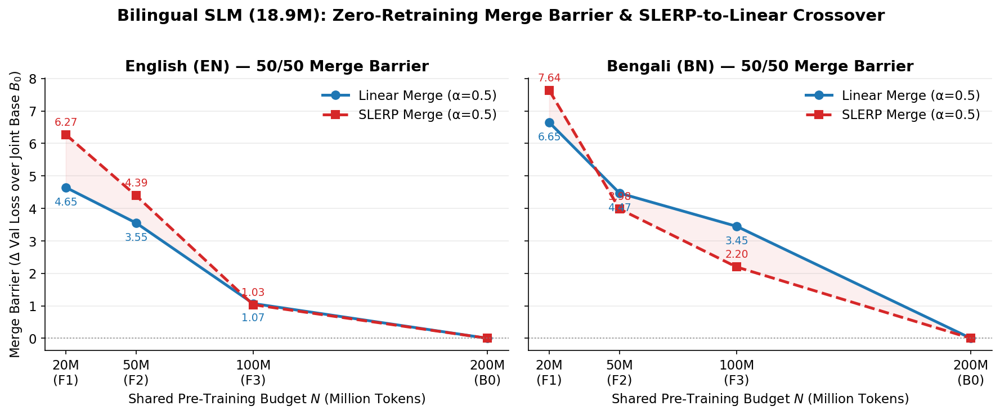
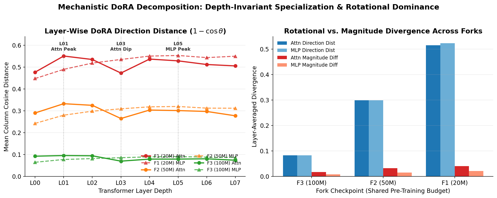

# Bilingual-SLM-18M (English–Bengali)

An 18.9M-parameter bilingual decoder-only Transformer implemented and trained from scratch in PyTorch on English and Bengali TinyStories, alongside a controlled ablation on zero-retraining weight merging (Linear vs. SLERP) across varying shared pre-training budgets.

## Resources & Checkpoints

* **Base Model & Fork Checkpoints:** [a-mondal/bilingual-slm-18m-b0](https://huggingface.co/a-mondal/bilingual-slm-18m-b0)
  * `b0_200M.pt` — Main joint bilingual base model (recommended for inference).
  * `f3_*`, `f2_*`, `f1_*` — Monolingual fork checkpoints hosted for reproducing the merge evaluations.
* **Pre-Packed Binary Dataset:** [a-mondal/tinystories-en-bn-16k-bin](https://huggingface.co/a-mondal/tinystories-en-bn-16k-bin) (`uint16` `.bin` files, 200M train + 2M val tokens per language).

---

## Architecture & Training Setup

Implemented from first principles in PyTorch without high-level model wrappers:

| Component | Specification |
| :--- | :--- |
| **Parameters** | 18.88M (with weight-tied input/output embeddings) |
| **Layers / Hidden Dim** | 8 Transformer blocks, `d_model = 384` |
| **Attention** | Grouped-Query Attention (GQA): 6 Query heads, 2 KV heads (`head_dim = 64`), RoPE |
| **Feed-Forward** | SwiGLU (`d_ff = 1024`), Pre-Norm `RMSNorm` |
| **Initialization** | Normal ($\sigma = 0.02$) with GPT-2/Llama residual scaling ($0.02 / \sqrt{2L}$) |
| **Tokenizer** | Custom 16,384-vocab Unicode BPE (`NFC` + `Metaspace` + `Punctuation` + `byte_fallback`) |
| **Optimizer** | AdamW ($\beta_1 = 0.9, \beta_2 = 0.95$, `weight_decay = 0.1` on 2D weights only) |
| **Precision & Batching** | `fp16` `autocast` + `GradScaler`, 32,768 tokens/step (`16 × 512 × 4` grad accum) |
| **Schedule** | 200-step linear warmup + cosine decay (`6e-4` → `6e-5`) over 6,104 steps (200M tokens) |

### Tokenizer Fertility Fix
Default byte-level BPE tokenizers severely over-segment Bengali UTF-8 sequences (~3.82 tokens/word). Training a custom 16k Unicode BPE tokenizer with `NFC` normalization and `Metaspace` pre-tokenization brought fertility down to **~1.03 tokens/word** for both English and Bengali, keeping sequence capacity balanced across scripts.

---

## Weight-Merging Ablation (Linear vs. SLERP)

To measure how shared pre-training affects Linear Mode Connectivity between English (SVO) and Bengali (SOV), monolingual branches (`en` and `bn`) were forked from the joint base `B0` at three shared token budgets ($N \in \{100\text{M}, 50\text{M}, 20\text{M}\}$) and trained to a fixed total budget of 200M tokens each. Branches were then merged 50/50 ($\alpha = 0.50$) with **zero retraining**.

| Experiment | Shared Tokens ($N$) | 50/50 Linear (EN / BN Loss) | 50/50 SLERP (EN / BN Loss) | Qualitative Output ($\alpha=0.50$) |
| :--- | :---: | :---: | :---: | :--- |
| **`B0` (Joint Base)** | 200M | 1.7238 / 1.1768 | 1.7238 / 1.1768 | Coherent EN & BN stories |
| **`F3` Fork** | 100M | 2.7941 / 4.6253 | **2.7576 / 3.3723** | Readable EN & BN with noticeable barrier |
| **`F2` Fork** | 50M | **5.2761** / 5.6480 | 6.1169 / **5.1589** | Degraded / broken subwords |
| **`F1` Fork** | 20M | **6.3697 / 7.8243** | 7.9963 / 8.8136 | Complete collapse / script bleed |





### Key Observations & Limitations
* **SLERP-to-Linear Crossover:** At moderate divergence (`F3`, 100M shared), SLERP outperforms Linear averaging (dropping Bengali loss by 1.25 points). Once branches diverge past a critical angle (`F2` and `F1`), SLERP degrades *faster* than Linear averaging on both languages.
* **No Free Lunch Below 100M Shared Tokens:** Even at 50% shared pre-training (`F3`), a clear merge barrier remains compared to `B0`. At 50M and 20M shared tokens, zero-retraining merging fails to recover usable generation.
* **Consistent Depth Profile:** Across all three fork budgets, column-wise cosine distance (`1 - cos θ`) between `en` and `bn` weights consistently peaks in early attention (`L01`), dips in mid-layer attention (`L03`), and peaks in deeper MLPs (`L05`). *(Note: raw magnitude differences in Figure 2 are plotted on their native scale and are not directly comparable to unit-bounded cosine distance.)*
* **Loss Asymmetry:** Raw Bengali validation loss is lower than English across all runs due to lower entropy/template repetition in the Bengali TinyStories split, not higher token allocation.

---

## Repository Structure

```text
bilingual-slm-18m/
├── assets/
│   ├── fig1_merge_barrier.png
│   └── fig2_dora_divergence.png
├── notebooks/
│   └── bilingual_slm_training_and_eval.ipynb
└── README.md